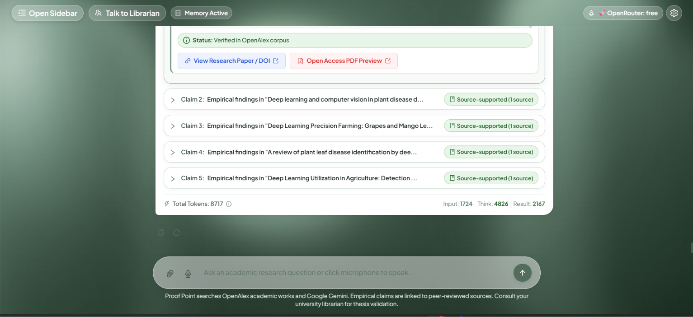

# Research Paper Discovery Hub 🔬📚

[](https://react.dev/)
[](https://x.ant.design/)
[](https://nodejs.org/)
[](https://dotnet.microsoft.com/)
[](https://openalex.org/)
[](https://aistudio.google.com/)
[](https://openrouter.ai/)

An advanced, human-centered AI platform (**HCAI**) for exploring, synthesizing, and verifying academic research papers. Built with a real-time streaming chat interface, grounded citations powered by the OpenAlex corpus (250M+ papers), dual AI providers (Google Gemini & OpenRouter), and a modern 3D ambient glassmorphism UI.

---
## Deployment & Live Demo

1. **Runs end to end from this repo:** the frontend is built by GitHub Actions and published to GitHub Pages at [https://mazenhisham1.github.io/Research-Paper-Discovery-Hub/](https://mazenhisham1.github.io/Research-Paper-Discovery-Hub/), and it calls the backend API hosted on Vercel at [https://research-paper-discovery-hub-git-main-mazen-681c.vercel.app/api](https://research-paper-discovery-hub-git-main-mazen-681c.vercel.app/api) (to run it locally, copy .env.example to .env.local, set VITE_BACKEND_URL to that Vercel URL, then run pnpm install && pnpm dev and open [http://localhost:3000](http://localhost:3000)). It needs two keys: an **OpenAlex API key**, set as an environment variable in the Vercel project (Settings → Environment Variables) as OPENALEX_API_KEY, and one AI key, either an **OpenRouter key** (sk-or-v1-...) or a **Google Gemini key** (AIza...), which you paste into **Settings** in the app after choosing the provider.

2. **Main feature, live in the running app:** ask a research question and get an answer whose claims are backed by linked peer-reviewed sources from OpenAlex, and every source link opens in a new tab (screenshot below).



---

## 📑 جدول المحتويات / Table of Contents
1. [Overview & Highlights](#-overview--highlights)
2. [Repository Structure](#-repository-structure)
3. [Prerequisites](#-prerequisites)
4. [Quick Start (Installation & Setup)](#-quick-start-installation--setup)
5. [API Keys Configuration](#-api-keys-configuration)
6. [Running the Application](#-running-the-application)
7. [Key Features](#-key-features)
8. [Alternative .NET Backend](#-alternative-net-backend)
9. [دليل التشغيل باللغة العربية (Arabic Quick Start)](#-دليل-التشغيل-باللغة-العربية-arabic-quick-start)

---

## 🌟 Overview & Highlights

- **Academic Grounding**: Synthesizes literature from real scientific papers fetched in real-time via the OpenAlex API with verified titles, DOIs, publication years, and abstract evidence.
- **Dual AI Provider Architecture**:
  - **Google Gemini**: Official integration with Gemini 2.5 Flash, thinking models, and citation formatting.
  - **OpenRouter**: Dynamic access to top reasoning and frontier models (DeepSeek R1, Claude 3.5 Sonnet, Llama 3.3, Mistral, Qwen, etc.).
- **Real-Time Token Streaming**: Server-Sent Events (SSE) streaming answers chunk by chunk with token usage breakdowns and collapsible reasoning/chain-of-thought blocks.
- **Interactive UI**: Ant Design X components, voice dictation, file attachments, copy/markdown rendering, and full Arabic/English bilingual support with automatic RTL/LTR switching.
- **Offline / Mock Mode**: A built-in offline simulation mode allowing complete UI and feature evaluation without needing active API keys.

---

## 📁 Repository Structure

The repository is organized cleanly into the executable software application and the academic project milestones:

```text
Research-Paper-Discovery-Hub/
├── application/                         # 🚀 Core Application Codebase
│   ├── frontend/                        # React 19 + TypeScript + Vite + Ant Design X UI
│   │   ├── src/                         # Components, services, styling, hooks
│   │   ├── public/                      # Static assets & icons
│   │   ├── package.json                 # Frontend dependencies & scripts
│   │   └── vite.config.ts               # Vite configuration (port 3000)
│   ├── server/                          # ⚡ Node.js Real-time Streaming API Server
│   │   ├── server.mjs                   # OpenAlex + Gemini + OpenRouter proxy & SSE stream
│   │   ├── package.json                 # Server scripts
│   │   └── .env.example                 # Server environment variables template
│   ├── ResearchHub/                     # 🛡️ ASP.NET Core 10 Web API (.NET C# Backend)
│   │   ├── Controllers/                 # REST controllers
│   │   ├── Services/                    # OpenAlex & Gemini services
│   │   ├── Models/                      # DTOs and data models
│   │   └── Dockerfile                   # Docker container configuration
│   ├── .env.example                     # Unified environment template
│   └── README.md                        # Application-specific documentation
├── scripts/
│   └── dev.mjs                          # Zero-dependency runner (starts backend & frontend together)
├── .github/
│   └── workflows/
│       └── deploy.yml                   # GitHub Actions workflow for GitHub Pages
├── Milestone1_Research_Paper_Hub.pdf    # Project milestone deliverables
├── ProofPoint AI - Week_3_...pdf        # User research & requirement analysis
├── ProofPoint AI - Week_4_...pdf        # System design & architecture docs
├── ProofPoint_AI_Week_5.pdf             # Midterm milestone documentation
├── Week 6-7/                            # Week 6 & 7 test sets, prompt logs, and demo scripts
├── API demo.mp4                         # System demo video
├── .env.example                         # Root environment variables template
├── DESIGN_SYSTEM.md                     # UI/UX design specifications
├── package.json                         # Root workspace scripts
└── README.md                            # Main project documentation
```

---

## ⚙️ Prerequisites

Make sure you have installed on your machine:
- **Node.js**: `v18.0.0` or higher (`v22.x` recommended). Verify with:
  ```bash
  node -v
  ```
- **Package Manager**: `pnpm` (recommended) or `npm`.
  ```bash
  pnpm -v   # or: npm -v
  ```
- *(Optional)* **.NET 10 SDK**: Only needed if you wish to run the alternative ASP.NET Core C# backend instead of the Node.js server.

---

## 🚀 Quick Start (Installation & Setup)

### 1. Clone the Repository
```bash
git clone https://github.com/MazenHisham1/Research-Paper-Discovery-Hub.git
cd Research-Paper-Discovery-Hub
```

### 2. Install Frontend Dependencies
```bash
cd application/frontend
pnpm install
# (or if using npm: npm install)
cd ../..
```

---

## 🔑 API Keys Configuration

Create your local environment file by copying the provided template:

```bash
cp .env.example .env.local
```
*(On Windows PowerShell: `Copy-Item .env.example .env.local`)*

Open `.env.local` in your favorite editor and configure your keys:

```ini
# ====================================================================
# ResearchHub Environment Variables
# ====================================================================

# 1. Google Gemini API Key (Required for Gemini models)
# Get a free key at: https://aistudio.google.com/app/apikey
Gemini__ApiKey=YOUR_GEMINI_API_KEY_HERE

# 2. OpenRouter API Key (Required for DeepSeek, Claude, Llama, etc.)
# Get a key at: https://openrouter.ai/keys
Open_Router_ApiKey=YOUR_OPENROUTER_API_KEY_HERE

# 3. OpenAlex Academic Research API (Optional, but recommended)
# Get a free key at: https://openalex.org/
OpenAlex__ApiKey=YOUR_OPENALEX_API_KEY_HERE

# Local server ports & endpoints
PORT=5023
VITE_BACKEND_URL=http://localhost:5023
VITE_DEFAULT_LANGUAGE=en
```

> [!TIP]
> **Where can `.env.local` be placed?**
> The backend server automatically searches for `.env.local` in the **root directory**, inside `application/`, or inside `application/server/`. Placing it in the root directory is recommended.

> [!NOTE]
> **No API Key yet?**
> You can still run the app! In the UI Settings modal (⚙️ icon), toggle on **"Mock / Demo Mode"** to test simulated responses, token breakdowns, and citations completely offline.

---

## 💻 Running the Application

### Option A: One Command from Root (Recommended)
You can launch both the **Backend API** and the **Frontend UI** simultaneously using:

```bash
npm run dev
```

- **Backend Server**: Starts at `http://localhost:5023`
- **Frontend App**: Starts at `http://localhost:3000`
- Both outputs are streamed to your terminal with color-coded tags `[Backend]` and `[Frontend]`.
- Press `Ctrl + C` once to gracefully shut down both services.

---

### Option B: Running Services in Separate Terminals

#### Terminal 1 — Start Backend Server:
```bash
cd application/server
node server.mjs
# or: npm start
# or: npm run dev (auto-reloads on file changes)
```
*The server will log `ResearchHub API backend listening on http://localhost:5023` and verify your API keys.*

#### Terminal 2 — Start Frontend:
```bash
cd application/frontend
pnpm dev
# (or: npm run dev)
```
*Open your browser and navigate to `http://localhost:3000`.*

---

## 🎨 Key Features

1. **Intelligent Paper Search & Citation Synthesis**:
   - Every question triggers an academic query to OpenAlex to retrieve peer-reviewed papers.
   - The AI models answer strictly grounded in the retrieved literature.
   - Clickable citation tags display paper abstracts, author lists, publication years, and external DOI links.

2. **Real-Time Streaming & Thinking Process**:
   - Responses stream in real-time via SSE.
   - For reasoning models (e.g., DeepSeek R1, Gemini Thinking), the thoughts are rendered inside a collapsible glass block.

3. **Dual Provider & Dynamic Model Switching**:
   - Seamlessly switch between Google Gemini and OpenRouter directly from the chat header dropdown.
   - Dynamic model fetching populates the latest available free and premium models.

4. **Speech-to-Text & Multimodal Inputs**:
   - Built-in microphone audio recording for voice questions.
   - Attach PDF research papers or images for contextual analysis.

5. **Ant Design X 3D Ambient Glass UI**:
   - Modern curved layout, floating message cards, adaptive dark/light contrast, and auto-scroll with manual override detection.

---

## 🛡️ Alternative .NET Backend

If you prefer using the C# ASP.NET Core 10 Web API backend:

```bash
cd application/ResearchHub
dotnet run
```
Or run with Docker:
```bash
docker build -t researchhub-backend application/ResearchHub
docker run -p 5023:10000 researchhub-backend
```
Swagger UI will be accessible at: `http://localhost:5023/swagger`

---

## 🇪🇬 دليل التشغيل باللغة العربية (Arabic Quick Start)

أهلاً بك في مشروع **Research Paper Discovery Hub**! تم تنظيم المشروع بحيث تجد جميع ملفات التطبيق (الواجهة والخادم) داخل مجلد `application/` بشكل منظم ومنفصل عن وثائق وتقارير المشروع الأكاديمي.

### خطوات التثبيت والتشغيل في دقائق:

#### 1. استنساخ المشروع (Clone):
```bash
git clone https://github.com/MazenHisham1/Research-Paper-Discovery-Hub.git
cd Research-Paper-Discovery-Hub
```

#### 2. تثبيت مكتبات الواجهة الأمامية (Frontend):
```bash
cd application/frontend
pnpm install
# أو إذا كنت تفضل استخدام npm:
# npm install
cd ../..
```

#### 3. إعداد مفاتيح الـ API (API Keys):
انسخ ملف الإعدادات التجريبي `.env.example` إلى ملف جديد اسمه `.env.local`:
```bash
cp .env.example .env.local
```
*(أو في ويندوز باورشيل: `Copy-Item .env.example .env.local`)*

افتح ملف `.env.local` وضع المفاتيح الخاصة بك:
- **`Gemini__ApiKey`**: مفتاح Google Gemini (يمكنك الحصول عليه مجاناً من [Google AI Studio](https://aistudio.google.com/app/apikey)).
- **`Open_Router_ApiKey`**: مفتاح OpenRouter لتشغيل نماذج DeepSeek R1 و Claude و Llama (من [OpenRouter](https://openrouter.ai/keys)).
- **`OpenAlex__ApiKey`**: مفتاح OpenAlex للبحث في الأوراق البحثية العلمية (مجاني من [OpenAlex](https://openalex.org/)).

> **ملاحظة**: لو مش معاك مفاتيح API حالياً، التطبيق فيه **Mock / Demo Mode** تقدر تفعله من الإعدادات ⚙️ وهيشتغل معاك بالكامل ببيانات وأوراق بحثية تجريبية للتجربة السريعة!

#### 4. تشغيل التطبيق بأمر واحد:
من المجلد الرئيسي للمشروع، نفذ الأمر التالي:
```bash
npm run dev
```
سيقوم هذا الأمر بتشغيل:
- خادم الـ API على: `http://localhost:5023`
- واجهة المستخدم (React) على: `http://localhost:3000`

أو يمكنك تشغيل كل طرف بشكل منفصل:
- **الخادم (Backend)**: ادخل إلى `application/server` ثم اكتب `node server.mjs`
- **الواجهة (Frontend)**: ادخل إلى `application/frontend` ثم اكتب `pnpm dev` أو `npm run dev`

---

## ☁️ Deployment Guide (Vercel & GitHub Actions)

### 1. Backend Hosting on Vercel
The backend (`server.mjs`) is configured with native Vercel Serverless Function entry points (`api/index.mjs` and `vercel.json`) with SSE streaming and 60-second execution timeouts:

1. Go to [Vercel Dashboard](https://vercel.com/) and click **"Add New Project"** -> **"Import Git Repository"**.
2. Select your repository `Research-Paper-Discovery-Hub`.
3. In Project Configuration:
   - **Framework Preset**: `Other`
   - **Root Directory**: Leave as `./` (or select `application/server` — both work out of the box).
   - **Build & Output Settings**: Leave empty / default.
   - **Environment Variables**: Add your API keys:
     - `Gemini__ApiKey`: (Your Google Gemini API Key)
     - `Open_Router_ApiKey`: (Your OpenRouter API Key)
     - `OpenAlex__ApiKey`: (Your OpenAlex API Key)
4. Click **Deploy**.
5. Once deployed, open your backend URL in your browser (e.g., `https://your-backend.vercel.app/` or `/health`). You will see an online status JSON confirmation!

### 2. Frontend Hosting on GitHub Actions (GitHub Pages)
The repository includes an automated GitHub Actions deployment workflow (`.github/workflows/deploy.yml`):
1. In your GitHub repository, navigate to **Settings** -> **Pages**.
2. Under **Build and deployment** -> **Source**, select **GitHub Actions**.
3. (Optional) In **Settings** -> **Secrets and variables** -> **Actions** -> **Variables**, add:
   - Name: `VITE_BACKEND_URL`
   - Value: `https://your-backend.vercel.app`
4. Any push to `main` will automatically build and publish your frontend to `https://<username>.github.io/<repo>/`.

---

### ☁️ دليل رفع الخادم (Backend) على Vercel والواجهة على GitHub Actions

#### أولاً: رفع الـ Backend على Vercel
1. سجّل الدخول إلى [Vercel](https://vercel.com/) واضغط **Add New Project**.
2. اختر المستودع `Research-Paper-Discovery-Hub`.
3. في إعدادات المشروع (Project Settings):
   - **Framework Preset**: اختر **Other**.
   - **Root Directory**: اتركه كما هو `./` (أو اختر `application/server`، كلاهما مدعوم ومجهز بالكامل).
   - في قسم **Environment Variables** أضف المفاتيح الخاصة بك:
     - `Gemini__ApiKey`
     - `Open_Router_ApiKey`
     - `OpenAlex__ApiKey`
4. اضغط **Deploy**.
5. بعد انتهاء الرفع سيعطيك Vercel رابطاً للخادم مثل: `https://your-backend.vercel.app`.
   عند فتح هذا الرابط في المتصفح ستظهر لك استجابة JSON تؤكد أن الخادم متصل وجاهز!

#### ثانياً: ربط الواجهة وتفعيل GitHub Actions
1. في صفحة المستودع على GitHub، ادخل إلى **Settings** ⬅️ **Pages**.
2. تحت خيار **Build and deployment -> Source** اختر **GitHub Actions**.
3. بعدما تحصل على رابط Vercel، أعطني إياه وسأقوم بتحديث الرابط الافتراضي للباك إند في كود الواجهة فوراً، أو يمكنك إضافته في إعدادات الريبو: **Settings -> Secrets and variables -> Actions -> Variables** باسم `VITE_BACKEND_URL`.

---

## 👥 Contributors & Academic Context

Developed as part of the **Human-Centered AI (HCAI)** Research Paper Discovery project.
All weekly milestones, research reports, user studies, and evaluation documents are located in the root repository.
